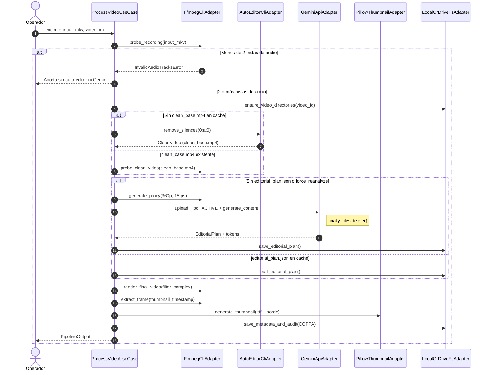
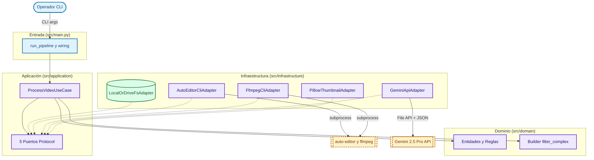

# yt_kids_video_pipeline

> Pipeline automatizado de postproducción de video para YouTube Kids que recorta silencios en grabaciones multipista, analiza eventos multimodales con Gemini API, realiza auditoría COPPA y renderiza el video final con efectos, música y miniatura mediante FFmpeg.

| | |
|---|---|
| **Estado** | Completado (11/11 tareas implementadas y verificadas) |
| **Responsable** | NO DOCUMENTADO (sin equipo ni autores definidos en `PROJECT.md` ni `pyproject.toml`) |
| **Repositorio** | NO DOCUMENTADO (sin remoto Git configurado) |
| **Última actualización** | 2026-11-20 |

> ⚠️ NO DOCUMENTADO: Responsable del proyecto y URL del repositorio remoto.

## 1. Propósito

Elimina el cuello de botella manual de edición en CapCut para videos de gaming infantil de aproximadamente 30 minutos grabados en OBS en formato `.mkv` multipista (1080p60, Pista 1 de voz y Pista 2 de juego). Produce de forma desatendida `final_video.mp4`, `thumbnail.jpg` y `metadata_and_audit.json` listos para subir a YouTube Kids, ejecutando el renderizado pesado en Google Colab Pro GPU o con fallback automático a CPU local.

Quedan fuera de alcance la subida automática mediante YouTube Data API v3, grabaciones en lienzo doble `3840x1080`, interfaz gráfica o web, exportación de líneas de tiempo XML/EDL, subtítulos palabra por palabra, fine-tuning y procesamiento en tiempo real.

## 2. Casos de uso

| Actor | Objetivo | Resultado esperado | Feature |
|---|---|---|---|
| Motor de dominio | Validar entidades inmutables, pistas de audio, duración del hook y separación de eventos | `RawRecording` exige al menos 2 pistas, `hook_clip` se ajusta a `[8.0, 15.0]` s y eventos `< 10.0` s se descartan | `1` |
| Constructor de filtros | Generar expresiones deterministas `filter_complex` de FFmpeg sin I/O | Extrae `hook_clip` al `00:00`, concatena `intro.mp4` y gameplay, aplica zoom `x=0,y=0`, SFX, `drawtext`, `-14 LUFS`, ducking, Music Drop y mute COPPA | `2` |
| Caso de uso | Orquestar las 5 etapas en secuencia estricta Silencios hacia IA con caché idempotente | Ejecuta 5 etapas, aborta si hay `< 2` pistas, reutiliza `clean_base.mp4` y `editorial_plan.json` salvo `--force-reanalyze` y audita COPPA | `3` |
| Adaptadores CLI y disco | Gestionar carpetas `00_assets`/`01_raw`/`02_staging`/`03_output` e invocar `auto-editor` y `ffmpeg` | Ejecuta subprocesos `list[str]` sin `shell=True`, usa `--edit audio:stream=0` y selecciona `h264_nvenc` o fallback `libx264` | `4` |
| Adaptadores IA e imagen | Analizar el proxy con Gemini 2.5 Pro y generar la miniatura mejorada | Sube proxy a File API, hace polling hasta `ACTIVE`, borra el archivo en `finally` y genera `thumbnail.jpg` con Pillow | `5` |
| Operador CLI | Ejecutar el pipeline completo por línea de comandos en local o Google Colab | Recibe `--input`, `--base-dir` y `--force-reanalyze`, valida `GEMINI_API_KEY` y registra métricas en consola y `pipeline.log` | `6` |

## 3. Flujo principal



El caso de uso `ProcessVideoUseCase` inspecciona primero las pistas con `ffprobe` (pasos 2–4) y aborta con `InvalidAudioTracksError` si existen menos de 2 streams de audio; luego ejecuta recorte de silencios sobre `0:a:0` (paso 7), análisis multimodal sobre proxy 360p/15fps con limpieza garantizada en `finally` (pasos 10–13), renderizado `filter_complex` (paso 16) y generación de miniatura junto con `metadata_and_audit.json` (pasos 17–19).

## 4. Arquitectura



El sistema sigue Arquitectura Hexagonal (Ports & Adapters): las dependencias apuntan siempre desde `src/main.py` y `src/infrastructure/` hacia `src/application/` y `src/domain/`, manteniendo el dominio completamente aislado de I/O y prohibiendo importaciones directas entre adaptadores.

| Capa o módulo | Responsabilidad | Puede depender de |
|---|---|---|
| `src/domain/` | Entidades inmutables, constantes, errores tipados y builder puro `filter_complex` | `stdlib` y `pydantic` (cero I/O) |
| `src/application/` | 5 puertos `Protocol` y orquestación secuencial en `ProcessVideoUseCase` | `src/domain/`, `stdlib`, `logging` |
| `src/infrastructure/` | Adaptadores concretos de disco, `auto-editor`, `ffmpeg`, Gemini File API y Pillow | `src/domain/`, `src/application/ports.py` |
| `src/main.py` | CLI `argparse`, logging estructurado, lectura de `GEMINI_API_KEY` y wiring | Todas las capas |

## 5. Requisitos previos

| Herramienta | Versión | Para qué |
|---|---|---|
| Python | `>= 3.11` | Ejecución del pipeline y suite de pruebas |
| `ffmpeg` y `ffprobe` | Sistema (PATH) | Inspección multimedia, proxy 360p/15fps, extracción de fotograma y renderizado |
| `auto-editor` | `v24+` | Recorte de silencios analizando únicamente la pista `0:a:0` (`--edit audio:stream=0`) |
| `pydantic`, `Pillow`, `PyYAML`, `google-genai` | Ver `requirements.txt` | Validación de modelos, miniatura y cliente Gemini File API |
| `pytest`, `pytest-cov`, `ruff` | Ver `requirements-dev.txt` | Pruebas automatizadas, cobertura y formato/lint |

## 6. Instalación y ejecución

**Validar entorno y calidad con el gatekeeper**

```bash
./init.sh
```

**Consultar ayuda de la interfaz CLI**

```bash
python -m src.main --help
```

**Ejecutar el pipeline sobre un archivo `.mkv` multipista**

```bash
python -m src.main --input /ruta/01_raw/episodio.mkv --base-dir /ruta/pipeline
```

Para forzar la regeneración del proxy y un nuevo análisis en Gemini aun cuando exista `editorial_plan.json` en caché, añadir `--force-reanalyze`.

Resultado esperado: generación de `final_video.mp4`, `thumbnail.jpg`, `metadata_and_audit.json` y `pipeline.log` dentro de `03_output/{video_id}/`.

## 7. Configuración

| Variable | Obligatoria | Descripción |
|---|---|---|
| `GEMINI_API_KEY` | Sí (si requiere análisis) | Clave de API de Google AI Studio leída solo desde entorno; nunca se registra en logs. Si `editorial_plan.json` ya existe en caché y no se usa `--force-reanalyze`, puede omitirse. |
| `COVERAGE_THRESHOLD` | No | Umbral mínimo de cobertura global exigido por `init.sh` (por defecto `85`). |
| `DOMAIN_COVERAGE_THRESHOLD` | No | Umbral mínimo de cobertura para `src/domain/` en `init.sh` (por defecto `100`). |

## 8. Pruebas

```bash
python -m pytest tests/ --cov=src --cov-report=term-missing
```

La suite actual cuenta con 69 pruebas automatizadas (unitarias en `tests/unit/` e integración con dobles en `tests/integration/infrastructure/`) con 100.00% de cobertura en `src/domain/` y 100.00% global. No realizan llamadas reales a red ni requieren `ffmpeg`, `ffprobe` o `auto-editor` instalados porque subprocesos y SDK se validan mediante mocks; la prueba de humo end-to-end con binarios reales en Google Colab Pro GPU se ejecuta manualmente según `docs/verification.md`.

## 9. Estructura del repositorio

```text
yt_kids_video_pipeline/
├── src/
│   ├── main.py                              # Punto de entrada CLI, logging y wiring
│   ├── domain/                              # Entidades, constantes, errores y builder FFmpeg puro
│   ├── application/                         # Puertos Protocol y ProcessVideoUseCase
│   └── infrastructure/                      # Adaptadores de disco, auto-editor, ffmpeg, Gemini y Pillow
├── tests/
│   ├── unit/                                # Pruebas puras de dominio, caso de uso y CLI
│   └── integration/infrastructure/          # Pruebas de adaptadores con subprocess/SDK mockeados
├── docs/                                    # Arquitectura, convenciones, verificación y diagramas
├── progress/                                # Análisis, plan, historial y estado de sesiones
├── init.sh                                  # Gatekeeper de formato, lint, arquitectura y cobertura
├── feature_list.json                        # Registro y estado de las 6 features
├── pyproject.toml                           # Configuración de poetry, ruff, pytest y coverage
├── requirements.txt                         # Dependencias de runtime para Colab
└── requirements-dev.txt                     # Dependencias de desarrollo y pruebas
```

## 10. Decisiones y limitaciones conocidas

| Tipo | Detalle | Origen |
|---|---|---|
| Decisión | Secuencia estricta Silencios hacia IA: el proxy 360p/15fps siempre se genera desde `clean_base.mp4` | `docs/architecture.md` |
| Decisión | Uso explícito de `--edit audio:stream=0` de `auto-editor` v24+ y borrado obligatorio en `finally` de File API | `progress/current.md` |
| Decisión | Polling activo con `client.files.get()` hasta `ACTIVE` antes de invocar `gemini-2.5-pro` | `progress/plan_yt_kids_video_pipeline.md` |
| Limitación | En entorno local Windows de desarrollo, `google-genai` y `auto-editor` no están instalados en Python global; se validan con mocks en CI y se instalan en Colab vía `requirements.txt` | `requirements.txt` |
| Limitación | El renderizado automático de diagramas a SVG/PNG con `mmdc` falló en este entorno (`Node v18.18.2`, `error: unknown option '-w'`); los diagramas se incluyen como bloques Mermaid en el README y fuentes `.mmd` en `docs/diagrams/src/` | `progress/docs_readme.md` |
| Limitación | No incluye subida a YouTube Data API v3, lienzo doble `3840x1080`, GUI ni subtítulos palabra por palabra | `PROJECT.md` |

## 11. Solución de problemas

| Síntoma | Causa probable | Solución |
|---|---|---|
| Error `InvalidAudioTracksError` inmediato | El `.mkv` de entrada tiene menos de 2 pistas de audio independientes | Verificar configuración de pistas en OBS (Pista 1 Voz, Pista 2 Juego) antes de reintentar |
| Código de salida `1` con mensaje de `GEMINI_API_KEY` | Falta la variable de entorno al requerir análisis multimodal | Exportar `GEMINI_API_KEY` en el entorno o usar caché existente de `editorial_plan.json` sin `--force-reanalyze` |
| Renderizado usa `libx264 -preset ultrafast` en lugar de GPU | El binario `ffmpeg` del entorno no reporta el codificador `h264_nvenc` | Ejecutar en entorno con GPU NVIDIA y compilación NVENC (Google Colab Pro GPU) |
| Error `bash` en Windows al ejecutar `./init.sh` | `bash` apunta a WSL sin distribución instalada | Ejecutar `./init.sh` desde Git Bash (`C:\Program Files\Git\bin\bash.exe`) |
| `clean_base.mp4` incompleto tras desconexión de Colab | El entorno de Colab se desconectó mientras `auto-editor` exportaba el archivo | Al reintentar, el caso de uso detecta el fallo en `ffprobe` y regenera automáticamente `clean_base.mp4` |

## 12. Mantenimiento

Regenerar diagramas SVG y PNG a partir de las fuentes editables en `docs/diagrams/src/`: ejecutar el script `render.py` del skill `documenter` (`python <ruta-skill>/scripts/render.py`).

Fuentes editables de los diagramas: `docs/diagrams/src/arquitectura.mmd` y `docs/diagrams/src/flujo-principal.mmd`.

Contacto o soporte: NO DOCUMENTADO (sin canal de soporte definido en los artefactos del proyecto).
